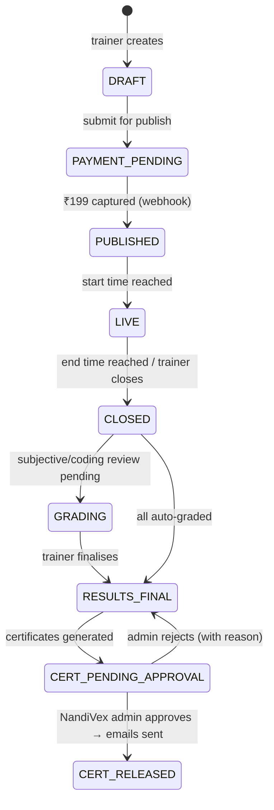
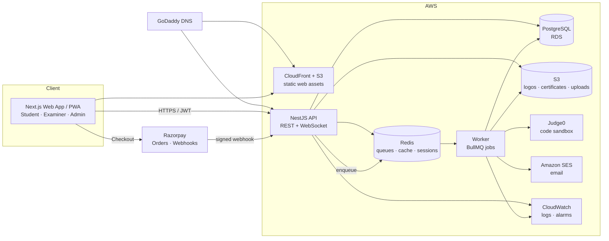

# Parakh: Product Implementation Plan

**Company:** NandiVex Technologies
**Product:** Parakh, a paid online assessment and certification platform
**Based on:** the existing Exam Hall codebase (rebuilt into a secure platform; see [../PROJECT_OVERVIEW.md](../PROJECT_OVERVIEW.md))
**Version:** 1.1 (16 Nov 2026): status updated after Sprint 0 and Sprint 1
**Repository:** https://github.com/devxjitin/parakh
**Staging:** web https://app-staging.parakh.nandivex.in · API https://api-staging.parakh.nandivex.in

Legend: ✅ done · 🟡 partly done · ⬜ not started · ⛔ blocked

---

**Scope update (21 Nov 2026):** Parakh supports single-answer MCQs, multiple-answer MCQs, and written questions. Coding questions, code execution, automatic code grading, and similarity reporting have been retired. The Sprint 6 report and related entries below record the original implementation. The [migration](apps/api/prisma/migrations/20261208100000_remove_coding_questions/migration.sql) converts existing coding prompts to written questions and keeps saved answers, awarded marks, and published results. Trainers can grade pending answers manually.

---

## Progress at a glance

| Phase         | Sprint                                                         | Status                                            | Notes                                                                                                                                                                                                                                       |
| ------------- | -------------------------------------------------------------- | ------------------------------------------------- | ------------------------------------------------------------------------------------------------------------------------------------------------------------------------------------------------------------------------------------------- |
| P0 Foundation | **S0** Setup                                                   | ✅ Done (with open items)                         | Monorepo, AWS staging, DNS/HTTPS, SES verified, deploy path proven. Open: GitHub Actions blocked by billing, Razorpay KYC, budget alerts, design/wireframes.                                                                                |
| P1 Core MVP   | **S1** Identity                                                | ✅ Done, live on staging                          | Accounts, email-code verification, login/refresh, password reset, roles, admin, audit log. 28 API tests.                                                                                                                                    |
| P1 Core MVP   | **S2** Exam builder                                            | ✅ Done, live on staging                          | Draft exams, single/multi/subjective questions, bulk import, private logo, student preview. 19 new API tests.                                                                                                                               |
| P1 Core MVP   | **S3** Creation payments                                       | ✅ Done with a fake provider                      | Publish flow, signed verify + idempotent webhook, receipts, exam codes. Real Razorpay needs your TEST keys (code is written, not yet run against Razorpay). 18 new tests.                                                                   |
| P1 Core MVP   | **S4** Join & take exam                                        | ✅ Done, on staging                               | Join by code + fee, server-timed attempt, shuffle, autosave, strikes. 24 new tests.                                                                                                                                                         |
| P1 Core MVP   | **S5** Grading & results                                       | ✅ Done locally, not deployed                     | Auto-marking, partial credit, written-answer marking, publish results, CSV. 36 new tests.                                                                                                                                                   |
| P2            | **S6** Coding engine · **S7** Integrity                        | S6, S7 ✅ done locally; S6 deployed, S7 not yet   | S7: question pools, one device per attempt, integrity report, join-code limiter, copied-code check. 22 new tests.                                                                                                                           |
| P3            | **S8** Ledger/payouts · **S9** Certificates · **S10** Practice | S8, S9 deployed; S10 ✅ done, deployed to staging | S10: practice sets unlock for students who took the exam once it is over; instant feedback, coding re-runs, scored rounds and history; practice never touches official scores. 18 new tests. Sets close 90 days after the exam closes (Q6). |
| P4            | **S11** Admin & migration · S12 Launch                         | S11 ✅ done locally, not deployed; S12 ⬜         |                                                                                                                                                                                                                                             |

**Sprints done: 10 of 13 (S0 to S9; S3 runs on a fake payment provider until Razorpay test keys are added).** Overall, the identity layer and the whole deployment pipeline (to staging) are in place; trainers can build draft exams; payments, taking exams and certificates do not exist yet.

**What exists today:** a private-by-default API with login and roles, a web app with sign-up/sign-in/profile/admin user list, a Postgres database with migrations, AWS staging (VPC, EC2, RDS, S3, CloudFront, ECR, SES, IAM deploy role), HTTPS on both hostnames, and 99 passing automated tests.

**Needs your action (cannot be done from code):**

1. Fix GitHub billing (Settings, Billing & plans) so Actions can run CI and deploys. Until then, deploys are run manually from a developer machine.
2. Wait for / follow up on the SES production-access request (status PENDING). Until approved, only verified addresses receive emails.
3. Complete Razorpay business KYC and create TEST keys (needed for Sprint 3).
4. Create the first admin account (see `README.md`, "First admin").
5. Optional: choose an email for AWS budget alerts (currently off).

---

## 0. Decisions already made

| Topic                   | Decision                                                                                                                                                                                                                                                                                                                                                                                                                                                                                                                        |
| ----------------------- | ------------------------------------------------------------------------------------------------------------------------------------------------------------------------------------------------------------------------------------------------------------------------------------------------------------------------------------------------------------------------------------------------------------------------------------------------------------------------------------------------------------------------------- |
| Backend hosting         | **AWS first.** API, database, storage, email and code runner on AWS. Firebase Spark is optional (e.g. push notifications later); it can't run server code.                                                                                                                                                                                                                                                                                                                                                                      |
| Existing Exam Hall code | **Rebuild and reuse features.** New secure, typed codebase. Port the question parser, the anti-cheat logic, the exam/grading flows and the UI ideas. Migrate real data.                                                                                                                                                                                                                                                                                                                                                         |
| Certificate approval    | The **NandiVex admin** approves certificates before they are released.                                                                                                                                                                                                                                                                                                                                                                                                                                                          |
| Coding questions        | Retired from the product scope on 21 Nov 2026.                                                                                                                                                                                                                                                                                                                                                                                                                                                                                  |
| Payments                | Razorpay (Orders, Checkout, Webhooks). All money lands in NandiVex's account; **the examiner's 50% is paid out manually** by NandiVex (no Razorpay Route).                                                                                                                                                                                                                                                                                                                                                                      |
| Domain                  | **`parakh.nandivex.in`** (a subdomain of the company domain `nandivex.in`, DNS at GoDaddy). Production: the platform is served at **`https://parakh.nandivex.in`** itself and its API at `https://api.parakh.nandivex.in`. Staging (moved, verified live on 2026-11-22): `app-staging.parakh.nandivex.in` / `api-staging.parakh.nandivex.in`. The old `assessiq.nandivex.in` staging names no longer resolve. The production names have not been set up yet (`parakh.nandivex.in` and `api.parakh.nandivex.in` do not resolve). |

### Deviations from the original plan (decided while building)

| Area                 | Plan said                         | What was built                                                                   | Why                                       |
| -------------------- | --------------------------------- | -------------------------------------------------------------------------------- | ----------------------------------------- |
| Package manager      | pnpm                              | npm workspaces                                                                   | pnpm was not installed; npm works fine    |
| Terraform locking    | DynamoDB table                    | S3 lock file (`use_lockfile`)                                                    | Simpler, no extra service                 |
| Web hosting          | Next.js static on S3 + CloudFront | Same, with `output: 'export'`, `trailingSlash` and a CloudFront rewrite function | Pretty URLs on a static export            |
| Prisma               | latest                            | Prisma 6                                                                         | Prisma 7/8 has breaking config changes    |
| Password hashing     | argon2id                          | `@node-rs/argon2` (argon2id)                                                     | Prebuilt binaries work on ARM Alpine      |
| Access token storage | not specified                     | In memory only; refresh token in an httpOnly cookie                              | Not readable by page scripts              |
| IDs                  | not specified                     | UUIDs (Postgres `uuid`)                                                          | Safer than sequential ids                 |
| CI/CD                | GitHub Actions deploy             | Workflows written; manual deploy used for now                                    | GitHub account billing blocks Actions     |
| ESLint, commit hooks | in Sprint 0                       | Not yet; Prettier only                                                           | Deferred                                  |
| Budget alerts        | $20/$50/$80                       | Off                                                                              | You skipped them; Terraform option exists |

---

## 1. Product scope

### 1.1 Roles

| Role                   | Who            | Can                                                                                                                                 |
| ---------------------- | -------------- | ----------------------------------------------------------------------------------------------------------------------------------- |
| **Student**            | Candidate      | Join an exam by code, pay ₹149 (or use a sponsored seat), take the exam, see results, use the practice set, receive the certificate |
| **Examiner / Trainer** | Creator        | Pay ₹199 per exam, build exams, upload a logo, sponsor seats, grade subjective answers, finalise results, view earnings             |
| **NandiVex Admin**     | Platform staff | Approve certificates, manage users/exams, payments, refunds, payouts, platform settings, audit logs                                 |
| _(Phase 5)_ Org Admin  | Institute      | Manage several trainers under one organisation                                                                                      |

### 1.2 Business rules

| #    | Rule                                                                                                                                                                                                          |
| ---- | ------------------------------------------------------------------------------------------------------------------------------------------------------------------------------------------------------------- |
| BR-1 | Creating an exam costs **₹199**. The exam stays in `DRAFT` until paid and can't be published without payment.                                                                                                 |
| BR-2 | Joining an exam costs **₹149 per student**, paid by the student **or** by the trainer on their behalf (sponsored seats).                                                                                      |
| BR-3 | For student-paid fees, **50% goes to the examiner and 50% to NandiVex**, tracked in a ledger. NandiVex **pays the examiner's 50% manually** (UPI/bank transfer) on a schedule; it is not split automatically. |
| BR-4 | Every exam has a unique **exam code**. Students join only with that code.                                                                                                                                     |
| BR-5 | When creating an exam, the trainer uploads a **custom logo**. Every certificate shows that logo **and** the NandiVex logo.                                                                                    |
| BR-6 | After a student takes the exam, a **practice set with the same questions** unlocks **only for that student**.                                                                                                 |
| BR-7 | Certificates are generated after results are final. They go to a **NandiVex admin approval queue** and are **emailed only after approval**, to the student's registered email.                                |
| BR-8 | Question types: **single-answer MCQ, multiple-answer MCQ, and written answers**.                                                                                                                              |

### 1.3 Exam lifecycle



### 1.4 Student attempt lifecycle

`ENROLLED (paid / sponsored)` → `IN_PROGRESS` (server records start time) → `SUBMITTED` / `AUTO_SUBMITTED` (time up or 3 strikes) → `GRADED` → `RESULT_PUBLISHED` → _practice set unlocked_ → `CERTIFICATE_ISSUED`

---

## 2. Target architecture

### 2.1 High level



### 2.2 Tech stack

| Layer            | Choice                                                                                                                   | Why                                                                         |
| ---------------- | ------------------------------------------------------------------------------------------------------------------------ | --------------------------------------------------------------------------- |
| Frontend         | **Next.js (React, TypeScript)**, Tailwind, shadcn/ui, Monaco editor, PWA                                                 | Typed, SEO for public pages (certificate verification), a good code editor  |
| API              | **NestJS (TypeScript)**, modular monolith                                                                                | Clear module boundaries, guards for RBAC, easy to split into services later |
| ORM / validation | Prisma + Zod (shared schemas)                                                                                            | Typed DB access; the same validation on client and server                   |
| Database         | **PostgreSQL** on Amazon RDS (`db.t4g.micro` to start)                                                                   | Relational data (payments, ledger, grades) needs transactions               |
| Queue / cache    | Redis + **BullMQ**                                                                                                       | Code grading, PDF generation, email                                         |
| Code execution   | **Judge0 CE** (self-hosted on EC2, Docker)                                                                               | Isolated sandbox, 60+ languages, time/memory limits                         |
| Files            | **S3** (private) + CloudFront signed URLs                                                                                | Logos, certificates, question images                                        |
| PDF              | HTML template → PDF (Playwright/Chromium in the worker)                                                                  | Pixel-accurate certificates with two logos and a QR code                    |
| Email            | **Amazon SES** (DKIM/SPF/DMARC on the domain)                                                                            | Cheap (~$0.10 per 1,000 emails), supports attachments                       |
| Auth             | In-house: argon2id passwords, short-lived JWT access + rotating refresh tokens (httpOnly cookie), email OTP verification | Full control; no per-user cost                                              |
| Payments         | Razorpay Orders API + Checkout + Webhooks                                                                                | Simple collection into one account; payouts handled manually by NandiVex    |
| IaC / CI         | Terraform (or AWS CDK) + GitHub Actions                                                                                  | Repeatable environments                                                     |
| Observability    | CloudWatch logs and alarms, Sentry (free tier)                                                                           | Error tracking                                                              |

### 2.3 Deployment (cost-aware for the $100 credit)

**Stage A: Launch (fits the credit for roughly 2–4 months):**

- **EC2 `t4g.medium`** running Docker Compose: `api`, `worker`, `redis`, `judge0` (server + workers), `caddy` (TLS via Let's Encrypt).
- **RDS PostgreSQL `db.t4g.micro`**, 20 GB, automated backups 7 days.
- **S3 + CloudFront** for the web app and files.
- **SES** for email.
- **Two environments:** `staging` (smaller EC2, can be stopped at night) and `production`.

**Stage B: Scale (when revenue justifies it):** API and worker on ECS Fargate behind an ALB, Judge0 on its own EC2 Auto Scaling group, RDS Multi-AZ, ElastiCache Redis, WAF.

> Indicative Stage A cost is **~$40–60/month** (EC2 ~$25, RDS ~$15, S3/CloudFront/SES a few dollars). These are estimates; check them in the AWS Pricing Calculator for your region (ap-south-1, Mumbai), and set an **AWS Budget alert at $20 / $50 / $80**.

### 2.4 Repository layout (monorepo)

```
assessiq/
├── apps/
│   ├── web/          # Next.js: student, examiner and admin areas
│   ├── api/          # NestJS: REST + WebSocket
│   └── worker/       # BullMQ consumers: grading, PDF, email
├── packages/
│   ├── shared/       # Zod schemas, types, enums, constants (prices, limits)
│   ├── ui/           # Shared React components
│   └── question-parser/   # Ported from Exam Hall parseQuestionsTxt (+ tests)
├── infra/            # Terraform, docker-compose, Caddyfile
├── legacy/exam-hall/ # Old code, read-only, for reference and data migration
└── .github/workflows/
```

### 2.5 API modules (NestJS)

`auth` · `users` · `exams` · `questions` · `attempts` · `proctoring` · `grading` · `code-runner` · `results` · `practice` · `payments` · `ledger` · `payouts` · `certificates` · `notifications` · `admin` · `audit` · `files`

### 2.6 Data model (core tables)

| Table               | Key columns                                                                                                                                                                    |
| ------------------- | ------------------------------------------------------------------------------------------------------------------------------------------------------------------------------ |
| `users`             | id, role (`STUDENT`/`EXAMINER`/`ADMIN`), name, email (unique, verified_at), phone, password_hash, status                                                                       |
| `examiner_profiles` | user_id, org_name, logo_s3_key, payout_method (`UPI`/`BANK`), upi_id, bank_account_name, bank_account_no_enc, ifsc, payout_details_verified_at                                 |
| `exams`             | id, examiner_id, title, description, code (unique), status, start_at, end_at, duration_min, pass_percent, shuffle_questions, shuffle_options, logo_s3_key, creation_payment_id |
| `questions`         | id, exam_id, type (`SINGLE`/`MULTI`/`SUBJECTIVE`/`CODING`), body, marks, negative_marks, order, explanation                                                                    |
| `question_options`  | id, question_id, text, is_correct                                                                                                                                              |
| `coding_specs`      | question_id, allowed_languages[], starter_code json, time_limit_ms, memory_kb                                                                                                  |
| `coding_test_cases` | id, question_id, input, expected_output, is_hidden, weight                                                                                                                     |
| `enrollments`       | id, exam_id, student_id, source (`SELF_PAID`/`SPONSORED`), payment_id, seat_id                                                                                                 |
| `sponsored_seats`   | id, exam_id, purchased_by, payment_id, assigned_email, redeem_token, redeemed_at                                                                                               |
| `attempts`          | id, enrollment_id, started_at, deadline_at, submitted_at, status, score, max_score, question_order json, strike_count                                                          |
| `answers`           | id, attempt_id, question_id, selected_option_ids[], text, code, language, awarded_marks, graded_by, feedback                                                                   |
| `code_submissions`  | id, answer_id, judge0_token, status, passed, total, stdout/err (truncated)                                                                                                     |
| `proctor_events`    | id, attempt_id, type, at, meta                                                                                                                                                 |
| `practice_access`   | student_id, exam_id, unlocked_at                                                                                                                                               |
| `practice_attempts` | id, student_id, exam_id, score, created_at                                                                                                                                     |
| `payments`          | id, razorpay_order_id, razorpay_payment_id, purpose (`EXAM_CREATION`/`EXAM_JOIN`/`SEAT_BUNDLE`), payer_id, exam_id, amount_paise, status, raw webhook                          |
| `ledger_entries`    | id, payment_id, account (`PLATFORM`/`EXAMINER:<id>`), amount_paise, type (`CREDIT`/`FEE`/`REFUND`/`PAYOUT`)                                                                    |
| `payouts`           | id, examiner_id, amount_paise, method, bank_ref/UTR, period_from, period_to, status (`REQUESTED`/`PAID`/`FAILED`), paid_by (admin), paid_at, note                              |
| `certificates`      | id, attempt_id, serial_no, status (`GENERATED`/`APPROVED`/`REJECTED`/`EMAILED`), pdf_s3_key, approved_by, approved_at, emailed_at, verify_hash                                 |
| `audit_logs`        | actor_id, action, entity, entity_id, before/after, ip, at                                                                                                                      |

### 2.7 Key flows

**A. Exam creation payment (₹199)**

1. Trainer clicks Publish. The API creates a Razorpay Order (`purpose=EXAM_CREATION`, `exam_id` in notes).
2. Checkout runs on the client. On success the client sends `payment_id` + signature, and the API verifies the signature.
3. The **webhook `payment.captured` is the source of truth**: mark paid, generate the exam code, move the exam to `PUBLISHED`. Handlers are idempotent on `razorpay_payment_id`.

**B. Student join (₹149) with manual 50/50 payout**

1. Student enters the code. The API shows exam info (no questions) and creates an Order.
2. Payment goes to NandiVex's Razorpay account (no split at payment time).
3. On capture (webhook): enrollment created, ledger written: PLATFORM +50% (less Razorpay fee, see Q2), **EXAMINER balance +50% (status `ACCRUED`)**.
4. Examiner share becomes `PAYABLE` once the exam is `RESULTS_FINAL` (refund window closed). Examiner sees "Accrued / Payable / Paid" balances on their dashboard.
5. **Manual payout:** admin opens the payout screen, sees every examiner whose payable balance is at or above the minimum (default ₹500), pays by UPI/bank, then records the UTR and marks the payout `PAID`. The ledger entry is written, the examiner is notified by email and gets a payout statement (CSV/PDF). The examiner can also click "Request payout".

**C. Sponsored seats (trainer pays for students)**

- Trainer buys N seats (₹149 × N) in one Order, then assigns them by email list / CSV or shares redeem links. A student who redeems is enrolled without paying.
- Payout split for sponsored seats: see **Open question Q1**.

**D. Taking the exam (server-authoritative)**

- `POST /attempts/start` records `started_at` and `deadline_at = min(start + duration, exam.end_at)`, and stores a per-student shuffled question/option order.
- Questions are delivered **without correct answers or hidden test cases**.
- Autosave every answer (debounced) plus offline queue retry. Submissions after `deadline_at + grace` are rejected.
- Anti-cheat (ported from Exam Hall): fullscreen, tab/blur detection, copy/paste and shortcut blocking, 3-strike auto-submit. **Every event is also sent to the server** (`proctor_events`), and the server decides auto-submit.

**E. Grading**

- Single MCQ: correct → +marks, wrong → −negative, blank → 0.
- Multi MCQ: configurable per exam: **all-or-nothing** (default) or **partial** (+marks × correct/total if no wrong choices).
- Coding: worker sends the code to Judge0 per test case. Score = Σ weights of passed cases. Students see sample-case results during the exam ("Run") and hidden results only after publish.
- Subjective: examiner grading screen with a model answer and rubric; marks capped at max.
- Examiner **finalises results**, which triggers the practice unlock and certificate generation.

**F. Practice set**

- Unlocks for a student **only if they have a submitted attempt**, and **only after the exam is `CLOSED`**, so that answers can't leak to students still taking it.
- Same questions in practice mode: unlimited attempts, instant feedback, explanations, coding re-runs. No proctoring, no certificate.

**G. Certificates**

1. On `RESULTS_FINAL`, the worker generates a PDF per student: student name, exam title, score/grade, date, **trainer logo + NandiVex logo**, a unique serial, and a QR code linking to `https://<domain>/verify/<serial>`.
2. The certificates go to the **NandiVex admin approval queue** (bulk approve per exam, preview, reject with reason).
3. On approval, the worker emails each student through SES with the PDF attached (or a signed download link). Bounces and complaints are tracked through SNS.
4. A public **verification page** shows whether a certificate is valid.

---

## 3. Security, compliance and quality

- **OWASP top 10**: input validation (Zod), parameterised queries (Prisma), output escaping (React), CSP headers, rate limiting (login, OTP, join-by-code), brute-force lockout.
- **Secrets** in AWS SSM Parameter Store, never in code. Razorpay webhook secret verification on every webhook.
- **RBAC + ownership checks** on every route (examiners only see their own exams; students only their own attempts).
- **Answer protection**: correct options, hidden tests and model answers never leave the server before publish.
- **Audit log** for payments, grading changes, certificate approvals and admin actions.
- **India DPDP Act 2023**: privacy policy, consent at sign-up, data export/delete requests, minimal data collection. Webcam data only with explicit consent (Phase 5).
- **Payments**: Terms, Refund & Cancellation policy, and Contact pages (Razorpay requires them for live mode). GST invoices (see **Q2**).
- **Testing**: unit tests (grading, parser, ledger and payout math), integration tests (API + DB), Playwright E2E for the main journeys, k6 load test (target: **500 concurrent students** in one exam on Stage A).
- **Backups**: RDS daily snapshots (7 days) plus S3 versioning on certificates.

---

## 4. Delivery plan: phases and sprints

**Assumptions:** 2-week sprints. A team of **2 full-stack developers + 1 part-time designer/QA**, with a NandiVex product owner. **13 sprints, about 26 weeks (~6 months)** to public launch. A larger team can run Phases 2 and 3 in parallel.

Each sprint ends with a demo on `staging` and a short retro. "Done" means code reviewed, tests passing, deployed to staging, and acceptance criteria met.

### Phase 0: Foundation (Sprint 0, weeks 1–2): ✅ Done, with open items

**Goal:** everything needed to build and ship safely, plus the long-lead external approvals.

| Status | Sprint 0 item                                                                | Detail                                                                                                                                                |
| ------ | ---------------------------------------------------------------------------- | ----------------------------------------------------------------------------------------------------------------------------------------------------- |
| ✅     | Git repo + monorepo scaffold (web / api / worker / shared / question-parser) | Repo is public at `devxjitin/parakh`; Prettier enforced                                                                                               |
| 🟡     | Lint, commit hooks                                                           | Prettier done; **ESLint and commit hooks not added**                                                                                                  |
| 🟡     | AWS account hardening                                                        | IAM admin user in use, ap-south-1 region used; root MFA not verified by us; **budget alerts skipped by choice**                                       |
| ✅     | Terraform: VPC, EC2, RDS, S3, CloudFront, ECR, SES, IAM                      | **Staging applied** and running. Production config written, **not applied**                                                                           |
| ✅     | Local dev stack                                                              | Docker Compose Postgres + Redis, verified                                                                                                             |
| ✅     | Docker images (API, worker, ARM64) and server deploy script                  | Built, pushed to ECR, deployed and health-checked on the server                                                                                       |
| 🟡     | GitHub Actions CI → staging deploy                                           | `ci.yml` and `deploy-staging.yml` written, OIDC role and environment variables created. **⛔ Blocked: GitHub account billing.** Deploys done manually |
| ✅     | DNS at GoDaddy (staging)                                                     | `app-staging`, `api-staging`, certificate validation and 3 DKIM records all verified. `verify.` subdomain not needed yet                              |
| ✅     | SES domain verification                                                      | `parakh.nandivex.in` verified (DKIM success, checked 2026-11-22). No custom MAIL FROM and no DMARC record yet                                         |
| ✅     | SES production-access request                                                | Submitted; **status PENDING** with AWS                                                                                                                |
| ⬜     | Razorpay business KYC and test keys                                          | **Your action**                                                                                                                                       |
| ⬜     | GST registration check                                                       | **Your action**                                                                                                                                       |
| ⬜     | Design system + wireframes                                                   | Not done; UI so far is a simple built-in style                                                                                                        |
| ✅     | Legacy audit                                                                 | `../PROJECT_OVERVIEW.md`; question parser ported with tests (125-question sample passes)                                                              |

**Exit criteria:** "Hello world" web + API deployed on staging over HTTPS ✅ (met). Razorpay test keys working ⬜ (pending your Razorpay account).

### Phase 1: Core assessment MVP (Sprints 1–5, weeks 3–12)

**Goal:** a trainer can pay ₹199 and publish an exam; a student can pay ₹149, take it and see results (MCQ + subjective).

| Sprint                       | Goal                | Scope                                                                                                                                                                                                                                 | Acceptance criteria                                                                                           |
| ---------------------------- | ------------------- | ------------------------------------------------------------------------------------------------------------------------------------------------------------------------------------------------------------------------------------- | ------------------------------------------------------------------------------------------------------------- |
| **S1: Identity** ✅          | Secure accounts     | Sign-up/login for Student and Examiner, email OTP verification (SES), JWT + refresh, password reset, RBAC guards, profile pages, admin seed user, audit log base                                                                      | Passwords hashed (argon2id); unverified emails can't join or create exams; role guards covered by tests       |
| **S2: Exam builder** ✅      | Build exams         | Exam CRUD (draft), settings (duration, window, pass %, shuffle, negative marks), **single + multi MCQ** and **subjective** editors, **logo upload** to S3, bulk import (ported parser, extended for multi-select), preview as student | Trainer builds a 100-question exam in under 10 minutes via import; logo stored privately                      |
| **S3: Creation payments** ✅ | ₹199 to publish     | Razorpay Orders + Checkout, signature verification, **webhook handler** (idempotent), payment records, invoice/receipt email, exam code generation (crypto-random, e.g. `NVX-7K3P9Q`), share link/QR/WhatsApp                         | Exam can't be published without a captured payment; a duplicate webhook doesn't double-process                |
| **S4: Join & take exam** ✅  | Student exam engine | Join by code → ₹149 payment → enrollment; exam lobby; **server-timed attempt**, per-student shuffle, autosave, navigator/flagging, submit/auto-submit; ported anti-cheat with server-side event logging and strike decision           | Answers survive a page refresh/network drop; late submissions rejected; the API never returns correct answers |
| **S5: Grading & results** ✅ | Results             | Auto-grade single/multi MCQ (all-or-nothing/partial), subjective grading screen with rubric and feedback, finalise results, student result page and scorecard, examiner dashboard (attempts, scores, violations), CSV export          | Grading math covered by unit tests; results hidden until finalised                                            |

#### Sprint 9 completion report ✅ (built and tested locally, including a manual run of the screens; **not yet deployed**)

| Scope item                 | Status                          | Where / how                                                                                                                                                                                                                                                                                                                                                                                                                                                    |
| -------------------------- | ------------------------------- | -------------------------------------------------------------------------------------------------------------------------------------------------------------------------------------------------------------------------------------------------------------------------------------------------------------------------------------------------------------------------------------------------------------------------------------------------------------- |
| Certificate designer       | ✅                              | Exam **Certificate** tab: classic or modern layout, five accent colours, optional heading and sentence, signatory name and title (the signature line), turn certificates off, give participation certificates or not. A **live PDF preview** redraws as the trainer edits, for both kinds. Locked once results are published                                                                                                                                   |
| Two logos                  | ✅                              | The trainer's logo (exam logo, else the account logo) on one side and the NandiVex logo on the other, on every certificate                                                                                                                                                                                                                                                                                                                                     |
| PDF generation             | ✅                              | A4 landscape PDF made in code (`pdf-lib`): holder, exam, score, date, signature line, serial and a **QR code** to the verification page. Made in the background after results are published (not on demand), stored privately, regenerated if the file is ever missing. Checked by eye in both layouts                                                                                                                                                         |
| **Two certificates**       | ✅                              | **Students** get a _Certificate of Achievement_ (and optionally a participation one). **Trainers** get a _Certificate of Appreciation_ for conducting an exam (one per exam, with the number of students who sat it, signed by NandiVex), made when results are published, approved in the same admin queue, emailed to the trainer, downloadable from their dashboard and publicly verifiable. A trainer can switch their own certificate off in the designer |
| **Samples on the website** | ✅                              | The landing page shows both sample certificates (images with a SAMPLE mark) with links to the sample PDFs and to the verify page. Made with the real renderer, so they always match what is issued (`apps/web/public/samples/`)                                                                                                                                                                                                                                |
| Who gets one (Q3)          | ✅                              | _Certificate of Achievement_ at or above the pass mark, _Certificate of Participation_ below it (trainer can switch participation off or certificates off entirely)                                                                                                                                                                                                                                                                                            |
| Admin approval queue       | ✅                              | **Certificates** page for NandiVex: exams with waiting/issued/rejected counts, **Approve all** for an exam, per-student **preview** of the real PDF, select several to approve or **reject with a reason**, tabs for waiting / emailed / sending / rejected. Nothing is emailed or downloadable before approval (tested)                                                                                                                                       |
| Email with PDF             | ✅                              | After approval a background job emails each student the PDF (raw MIME through SES, with a text fallback), 10 at a time, retrying failures with a growing pause up to 5 times. Students can also **download** from their dashboard once issued                                                                                                                                                                                                                  |
| Bounce handling            | ✅ in code, ⬜ not wired in AWS | `POST /mail/ses-events?key=...` receives SNS notices (bounce, complaint, delivery), stores them once, and flags the certificate so the admin sees "email bounced" and can resend. Terraform has the subscription (`ses_events_endpoint`, off by default); it is not applied                                                                                                                                                                                    |
| Public verification        | ✅                              | `/verify/?serial=...` (no sign-in): genuine / withdrawn / not found, showing holder, certificate type, exam, trainer's organisation and date, **never** the score or email. Each certificate carries a signature (HMAC) of its printed facts; a record edited in the database no longer verifies. A rejected-after-issue certificate shows as withdrawn                                                                                                        |
| Resend                     | ✅                              | Admin **Resend** for any issued certificate                                                                                                                                                                                                                                                                                                                                                                                                                    |
| Tests                      | ✅                              | **25 API tests** (template, creation rules, the trainer's certificate, approval gate, email retries, verification and tampering, bounces and raw email); repo total 235 regular tests                                                                                                                                                                                                                                                                          |

**Findings worth knowing:**

- The PDF is drawn with `pdf-lib` and the built-in fonts, not Chromium (the plan's first idea). That keeps the server image small and fast, and the layout is exact, but the fonts only cover **Latin letters**: a name in another script (Hindi, Tamil) prints as `?`. Fixing this needs a bundled font per script.
- The public verification page is a query-string page (`/verify/?serial=...`), not `/verify/<serial>`, because the web app is a static export.
- Serial numbers are 12 random characters (60 bits), so they cannot be guessed one by one; the verify endpoint is also rate limited.
- A student whose results are published but whose attempt ended by strikes still gets a certificate in the queue; the admin can reject it. There is no automatic rule for this.
- Certificates are only made when the trainer publishes results _after this release_. Exams already finalized have none (staging has none yet).
- The mail-events endpoint is protected by a secret in its URL (SNS cannot send a token). The SNS signature itself is not verified.

**Acceptance criteria:** no certificate is emailed before admin approval ✅ (tested); the verification page shows the correct holder and exam ✅.

**Known gaps after Sprint 9:**

- Not deployed; the SNS subscription for bounces is not created; real SES delivery of attachments has not been run (staging SES is still in sandbox, so it can only email verified addresses).
- Certificates only in Latin script; no LinkedIn sharing or custom per-trainer templates (later, per the plan).

#### Sprint 8 completion report ✅ (deployed to staging on 2026-11-17)

| Scope item                  | Status | Where / how                                                                                                                                                                                                                                                                                                                                                                                                                  |
| --------------------------- | ------ | ---------------------------------------------------------------------------------------------------------------------------------------------------------------------------------------------------------------------------------------------------------------------------------------------------------------------------------------------------------------------------------------------------------------------------- |
| Double-entry ledger         | ✅     | Every payment is booked in the same database transaction that captures it. Accounts: `EXTERNAL` (money in/out), `PLATFORM` (NandiVex), `EXAMINER:<id>` (owed to a trainer), `PAYOUTS`. Each transaction adds up to exactly zero; the code refuses anything else. A student's ₹149 becomes ₹74.50 to the trainer and ₹74.50 to NandiVex (odd paise go to NandiVex); a publishing fee and sponsored seats go fully to NandiVex |
| Trainer earnings dashboard  | ✅     | **Earnings** page: Payable now, Accruing (results not yet published), Requested, Paid so far, a per-exam table and payout history                                                                                                                                                                                                                                                                                            |
| Accrued → payable           | ✅     | A trainer's share is _accruing_ until the exam's results are published (the refund window), then _payable_                                                                                                                                                                                                                                                                                                                   |
| Payout details (UPI / bank) | ✅     | UPI id, or bank name + account number + IFSC. The account number is encrypted (AES-256-GCM) and only the last four digits are ever shown to the trainer; the admin sees the full number only on the payout screen. Changing details clears the "checked by NandiVex" mark                                                                                                                                                    |
| Admin payout screen         | ✅     | **Payouts** page: who is owed money, requests, trainer's destination, "mark details checked", then **Mark paid** with the bank/UPI reference (UTR) or **Reject** with a reason. An admin can also pay without a request. Minimum payable ₹500. Two admins cannot pay the same request twice (database lock)                                                                                                                  |
| Payout statements           | ✅     | CSV per paid payout (trainer or admin): who, amount, where, UTR, date and every earning or refund in the period; the trainer is also emailed when paid                                                                                                                                                                                                                                                                       |
| Refunds                     | ✅     | Admin **Payments** page: search, **Refund** with a reason. The gateway returns the money, the ledger reverses both shares exactly (so the trainer's accrued share drops), the enrollment or seats are cancelled and the customer is emailed. Refused if the student already started the exam, if sponsored seats were used, and for publishing fees. A refund after the trainer was paid shows as "owed back"                |
| Sponsored seats             | ✅     | Exam **Seats** tab: buy 1 to 200 seats (N x ₹149, one payment), reserve seats by email (each student is emailed a personal link) or copy open links. A student opens the link and joins without paying. Unused seats count against the exam's student limit. No trainer share on sponsored seats (default Q1)                                                                                                                |
| Ledger check                | ✅     | Admin page shows collected, NandiVex revenue, owed to trainers, paid out, and a live "all transactions balance to the paisa" check                                                                                                                                                                                                                                                                                           |
| Tests                       | ✅     | **24 API tests** and **7 shared tests** (math, validation); repo total 210 regular tests                                                                                                                                                                                                                                                                                                                                     |

**Findings worth knowing:**

- The gateway fee (about 2% at Razorpay) is **not** deducted anywhere: the split is on the gross amount and NandiVex absorbs the fee (default Q2). Real fees will only be known once Razorpay is live.
- GST is not modelled; the amounts are treated as inclusive. Q2 (accountant check) is still open before go-live.
- Bank account numbers are encrypted with `DATA_ENCRYPTION_KEY` (staging gets its own key; if it is not set the app falls back to `OTP_SECRET`). **Changing the key makes saved account numbers unreadable**, and the admin screen then asks the trainer to re-enter them.
- A refund asks the gateway first, then writes the ledger. If the server dies between the two, the payment is marked refunded but the ledger entry is missing; the ledger check would still balance, so a reconciliation report against Razorpay is worth adding before launch.
- Real Razorpay refunds have not been run (there are no live or test keys yet); the fake gateway refunds instantly.
- Student refunds are admin-only for now; there is no self-service refund request.

**Acceptance criteria:** for each ₹149 payment the ledger balances to the paisa ✅ (tested for odd amounts too); a refund reverses both shares ✅; paying out creates a ledger entry and statement ✅; sponsored students join without paying ✅.

**Known gaps after Sprint 8:**

- Not deployed yet; staging runs Sprint 7.
- Payout statements are CSV only (no PDF).
- No scheduled payout day or reminder emails; payouts happen when an admin acts.
- No GST invoices, no Razorpay settlement reconciliation.

#### Sprint 7 completion report ✅ (built and tested locally; **not yet deployed**)

| Scope item                                | Status                | Where / how                                                                                                                                                                                                                                                                                                                                                                                   |
| ----------------------------------------- | --------------------- | --------------------------------------------------------------------------------------------------------------------------------------------------------------------------------------------------------------------------------------------------------------------------------------------------------------------------------------------------------------------------------------------- |
| Shuffle questions and options per student | ✅ (done in Sprint 4) | Each attempt stores its own question and option order                                                                                                                                                                                                                                                                                                                                         |
| Question pools (random N of M)            | ✅                    | New setting **Questions per student** on the exam. Each student gets a random N; only those are shown, marked and counted in their maximum score. Publishing is refused if N is more than the number of questions. Students see the pool size before paying                                                                                                                                   |
| One device per attempt                    | ✅                    | The web app keeps a random device id in the browser and sends it with every request. The first device that talks to a running attempt owns it; another device gets a clear "already open on another device" error on every call (load, save, run, submit, events). Same device: reload and a second tab are fine. The trainer's **Release device** button lets the student continue elsewhere |
| IP and device record                      | ✅                    | Per attempt: IP at start and last IP, browser string, device id; each proctor event also stores the IP                                                                                                                                                                                                                                                                                        |
| Violation timeline and report             | ✅                    | The marking screen has an **Integrity report**: flags in plain language, where it started and last seen, shared-device students, and a timeline of events with IPs. The results table has an Integrity column with badges                                                                                                                                                                     |
| Join code rate limits                     | ✅                    | Wrong codes are counted per student: 8 misses in 10 minutes pauses lookups (429) for that student, on top of the existing 30 per minute per IP. Right codes never count                                                                                                                                                                                                                       |
| Plagiarism check on coding answers        | ✅                    | **Copied code check** on the results tab: token 5-gram similarity between students (comments, spacing, variable names and literal values ignored; starter code ignored; same language only; tiny programs skipped). Pairs at 80% or more are listed per question with links to both answers                                                                                                   |
| Tests                                     | ✅                    | **15 API tests** (devices, release, shared device, pools and marking, join limiter, similarity) and **7 shared tests**; repo total 179 regular tests                                                                                                                                                                                                                                          |

**What the flags mean (advisory, never automatic penalties):** _Other device blocked_ (a second device tried this attempt), _Shared device_ (two students used the same browser), _Network changed_ (IP at start differs from the latest; common on phones), _No device id_ (the browser did not send one).

**Findings worth knowing:**

- Device binding stops casual sharing and logging in from a second machine. It is **not tamper-proof**: a student can clear browser storage or use another browser profile _before_ starting, and a script can omit the id (the attempt is then simply flagged _No device id_ and binds to the first request that sends one).
- Many students on one network (a classroom) share an IP, so IP alone proves nothing; that is why only a _change_ of IP is flagged, and only as information.
- With a pool, marks per question should be equal, otherwise some students get a harder paper. Totals shown to the trainer are for a "typical" student; each student's own maximum is exact.
- The similarity check cannot tell copying from two people writing the same short, standard solution; the trainer decides. It runs when asked (not in the background) and compares up to 600 answers per question and language.
- One session per attempt is enforced per _device_, not per tab: two tabs on the same device both work.

**Acceptance criteria:** a second device cannot continue the same attempt ✅; the examiner sees a per-student violation report ✅. Not browser-tested end to end by hand (API behaviour is covered by tests; the new web screens compile and build).

**Known gaps after Sprint 7:**

- Not deployed yet; staging runs Sprint 6.
- No webcam or screen proctoring, no IP allow-lists, no live "who is online" view.
- Similarity checks only coding answers, and only within one exam.

#### Sprint 6 completion report ✅ (tested locally against a real Judge0; deployed to staging on 2026-11-17, but the code-execution host is **not created yet**)

| Scope item               | Status                     | Where / how                                                                                                                                                                                                                                                                                                                                                                                              |
| ------------------------ | -------------------------- | -------------------------------------------------------------------------------------------------------------------------------------------------------------------------------------------------------------------------------------------------------------------------------------------------------------------------------------------------------------------------------------------------------- |
| Coding question type     | ✅                         | Statement, allowed languages (Python, C, C++, Java, JavaScript), starter code per language, time and memory limits, up to 20 test cases (sample or hidden, with weights). Trainer editor in the exam builder; preview shows samples only                                                                                                                                                                 |
| Student coding screen    | ✅                         | Language picker, code editor (tab key works, starter code, per-language drafts), the sample cases, **Run on samples** with per-case result (passed, wrong answer, compile error with the compiler message, runtime error, time or memory limit). Autosaved like any answer. Limits: one run every 3 s and 40 runs per question                                                                           |
| Hidden cases stay hidden | ✅                         | Hidden inputs and outputs are never sent to browsers (tested on the exam, preview, attempt and result APIs) and are never run by the Run button; students see only pass or fail per hidden case, after results are published                                                                                                                                                                             |
| Automatic grading        | ✅                         | When an attempt ends, each coding answer is queued; a background judge runs every test and awards `marks x passed weight / total weight`. Jobs live in the database (survive restarts, safe with several servers), failed sandbox calls retry with a pause and give up after 5 tries so the trainer can mark by hand. Trainer marks are never overwritten                                                |
| Trainer view             | ✅                         | Marking screen shows the code, language, per-test outcome, marks override and feedback; results cannot be published while code is still being judged                                                                                                                                                                                                                                                     |
| Sandbox                  | ✅                         | **Judge0 CE 1.13.1**, network disabled, process/thread cap, output cap, CPU and wall time limits, memory limit. Tested live: Python, C, C++, Java, JavaScript; compile and runtime errors; infinite loop and sleep (killed); memory hog and fork bomb (contained); no network; output flood. 13 live tests, run with `LIVE_JUDGE0_URL=http://localhost:2358 npx vitest run src/code/judge0.live.test.ts` |
| Infrastructure           | ✅ written, ⬜ not applied | `infra/terraform/judge0.tf`: a separate x86 host (the Judge0 image has no ARM build), reachable from the app host only, off by default (`enable_judge0`). Validated, not applied                                                                                                                                                                                                                         |
| Tests                    | ✅                         | **22 API tests** (authoring, privacy, run limits, queue, retries, trainer override, publishing gates) plus the 13 live sandbox tests; repo total 157 regular tests                                                                                                                                                                                                                                       |

**Findings worth knowing:**

- **Judge0 1.13 does not work with cgroup v2 hosts out of the box** (Amazon Linux 2023 and Docker Desktop are cgroup v2): every run failed with an internal error. We use Judge0's per-process limits instead (`JUDGE0_LIMIT_MODE=process`, default). Node.js and Java reserve far more address space than they use, so they get a higher floor (1 GB and 3 GB) and the Judge0 host sets `MAX_MEMORY_LIMIT=4000000`. A cgroup v1 host can use `JUDGE0_LIMIT_MODE=cgroup` for exact memory accounting.
- Per-process limits are weaker than whole-sandbox limits: a program can use up to the per-process cap in each of its (at most 30) processes. Acceptable for staging and a first launch; revisit before large real exams.
- The background judge runs inside the API process for now (the queue is in the database, so moving it to the worker later is easy).
- The Judge0 image is x86 only, so it cannot share the ARM app host.

**Acceptance criteria:** the five languages work ✅; an infinite loop and a fork bomb are killed within limits ✅; 50 concurrent submissions was **not** load-tested (the judge handles `CODE_JUDGE_CONCURRENCY`, default 4, at a time; load testing needs the real host).

**Known gaps after Sprint 6:**

- **Not deployed and no code host exists yet:** until you approve creating the Judge0 host (about $30/month for a `t3.medium`) and set `CODE_RUNNER=judge0` and `JUDGE0_URL` in SSM, staging has `CODE_RUNNER=disabled`: trainers can write coding questions, but students cannot run code and answers must be marked by hand.
- The code editor is a plain text area (tab key, monospace), not Monaco: no syntax colouring or autocomplete.
- No plagiarism check yet (Sprint 7). No custom checkers: output is compared as text.
- Java must use a class called `Main`; input is read from stdin only.

#### Sprint 5 completion report ✅ (deployed to staging on 2026-11-17)

| Scope item                       | Status | Where / how                                                                                                                                                                                                                                                                                                          |
| -------------------------------- | ------ | -------------------------------------------------------------------------------------------------------------------------------------------------------------------------------------------------------------------------------------------------------------------------------------------------------------------- |
| Auto-marking of choice questions | ✅     | Marked by the server the moment an attempt ends (submit, time up, or 3 strikes). Single: right = marks, wrong = minus the penalty, blank = 0. Multiple: exact set = marks; optional **partial credit** per question (only correct options picked, none wrong); anything else = penalty. The total never goes below 0 |
| Written answers                  | ✅     | Trainer marking screen shows the answer, the marking guide and the student's proctor events; marks (0 to the question maximum) plus optional feedback; blank answers score 0 automatically                                                                                                                           |
| Finalise and publish             | ✅     | Allowed once the exam has closed and every written answer is marked; moves the exam to `RESULTS_FINAL`, locks all marks, and releases results to students. Students cannot see scores or correct answers before that (tested)                                                                                        |
| Student result page              | ✅     | Score, percent, pass/fail, and a full review (their answer, the correct answer, explanation, trainer feedback) in the order they saw the questions; dashboard shows "Average score" and a pass/fail badge                                                                                                            |
| Trainer results dashboard        | ✅     | New **Results** tab: attempts, submitted, average, pass rate, a table with score, strikes, violation count; refresh, **CSV export**, publish                                                                                                                                                                         |
| Abandoned attempts               | ✅     | Attempts nobody reopened are auto-submitted and marked when the trainer opens results or publishes (no background job needed)                                                                                                                                                                                        |
| Tests                            | ✅     | **14 grading-math unit tests** and **22 API tests** (marking, negative marks, partial credit, floor at zero, strikes and time-up, marking rules, ownership, publish gates, result privacy, CSV and formula-injection protection); repo total 135                                                                     |

**Acceptance criteria:** grading math covered by unit tests ✅; results hidden until finalised ✅ (tested at the API and in the browser).

**Known gaps after Sprint 5:**

- **Not deployed:** staging still runs Sprint 4. Deploy needs `aws login` (preferably as `jitin-admin`, not root).
- Students are not emailed when results are published; they see them on their dashboard.
- Marks on a written answer cannot be changed after publishing (no re-grade/appeal flow yet).
- Choice marks cannot be overridden by hand; a wrong answer key means fixing the exam before publishing.
- The CSV export lists attempts only (students who never started are not listed).
- Coding questions are Sprint 6; until then only the three existing question types are marked.

#### Sprint 4 completion report ✅ (deployed to staging 2026-11-17)

| Scope item                     | Status      | Where / how                                                                                                                                                                                                                                    |
| ------------------------------ | ----------- | ---------------------------------------------------------------------------------------------------------------------------------------------------------------------------------------------------------------------------------------------- |
| Join by code                   | ✅          | `GET /join/:code` (rate limited; forgives case, spaces, missing dash); web `/join/`                                                                                                                                                            |
| Join fee (₹149) and enrollment | ✅          | Same payment pipeline as publishing (order, signed verify, webhook); a captured join payment creates the enrollment exactly once; receipt email                                                                                                |
| Seat limit and closed exams    | ✅          | Checked at order time and again at capture; a paid order with no seat is flagged in the audit log for a manual refund                                                                                                                          |
| "My exams" and start/resume    | ✅          | `GET /me/enrollments`; dashboard list with Start / Resume                                                                                                                                                                                      |
| Server-timed attempt           | ✅          | The server fixes the deadline (start + duration, capped at the closing time); the browser only displays a countdown. 3 s grace on saves; late writes rejected; an overdue attempt auto-submits the next time it is touched                     |
| Per-student shuffle            | ✅          | Question and option order chosen by the server per student; answers are stored against the original option index                                                                                                                               |
| Autosave, navigator, flagging  | ✅          | Debounced autosave with retry; answers survive reload; navigator shows answered and flagged                                                                                                                                                    |
| Submit                         | ✅          | Confirm dialog, then locked; the attempt cannot be restarted                                                                                                                                                                                   |
| Answers never leak             | ✅          | The attempt API never returns correct answers, explanations or rubrics (tested)                                                                                                                                                                |
| Anti-cheat (ported)            | ✅ advisory | Fullscreen exit, tab hidden and window blur cost a strike (events within 2 s count once); copy, paste, right-click and devtools keys are blocked and logged; 3 strikes auto-submit. The server counts and decides; the browser can only report |
| Tests                          | ✅          | **24 new API tests** (89 in the API, 99 in the repo); join, attempt, timing and strike flows also clicked through in a real browser                                                                                                            |

**Acceptance criteria:** answers survive a page refresh ✅ (tested and seen in the browser); late submissions rejected ✅; the API never returns correct answers ✅.

**Known gaps after Sprint 4:**

- **Deployed:** Sprints 3 and 4 and the new UI went to staging on 2026-11-17 (fake payment provider, so publishing and joining are free there).
- Proctoring is advisory: a determined student can stop the browser reporting events (second device, modified client). The server cannot see the screen.
- No sweeper yet: an attempt nobody opens again stays `IN_PROGRESS` until the grading sprint adds a job that auto-submits overdue attempts.
- Grading and results are Sprint 5; a submitted student only sees "Exam submitted".
- No "waiting room" countdown before the exam opens; students can join early but only start once it opens.
- Students on a shared network are exempt from the per-IP rate limit on exam routes by design; login routes keep theirs.

#### Sprint 3 completion report ✅ (fake payment provider; deployed to staging 2026-11-17)

| Scope item                                        | Status               | Where / how                                                                                                                             |
| ------------------------------------------------- | -------------------- | --------------------------------------------------------------------------------------------------------------------------------------- |
| Order + Checkout flow for the creation fee (₹199) | ✅                   | `POST /exams/:id/publish-order` (resumes an open order, never duplicates), web **Publish** tab                                          |
| Signature verification                            | ✅                   | `POST /payments/verify`; HMAC compared in constant time; wrong signature or another user's order is refused                             |
| Webhook handler, idempotent                       | ✅                   | `POST /payments/webhook`; raw-body signature check, duplicate events ignored, recorded after processing so gateway retries are safe     |
| Exactly-once publish                              | ✅                   | The status flip and publish happen in one transaction; browser and webhook can arrive in any order                                      |
| Payment records                                   | ✅                   | `Payment` table: integer paise, GST-inclusive, receipt number `PRK-R-000001`, provider ids, status                                      |
| Receipt email                                     | ✅                   | Sent once, with code, share link and amount. This is a receipt, **not a GST invoice** (needs GST registration details)                  |
| Exam code                                         | ✅                   | `NVX-` + 6 characters from an unambiguous alphabet; unique                                                                              |
| Share link, WhatsApp                              | ✅                   | Copy code, copy link, WhatsApp share. QR code is not done                                                                               |
| Publish rules                                     | ✅                   | At least one question; window set, in the future, and at least as long as the exam                                                      |
| Money-safety checks                               | ✅                   | Amount in the webhook must match; late "failed" never downgrades a captured payment; paid-but-exam-deleted is flagged for manual refund |
| Fake provider                                     | ✅                   | `PAYMENT_PROVIDER=fake` (default). Simulates checkout; logs a warning at startup. **Must not be used in production**                    |
| Real Razorpay                                     | ⚠️ written, untested | Orders via REST, Checkout script, signature scheme per Razorpay docs. Needs TEST keys and a webhook; then run one test payment          |
| Tests                                             | ✅                   | **18 new API tests**; 75 in the whole repo; the flow was also clicked through locally in a browser                                      |

**Acceptance criteria:** an exam cannot be published without a captured payment ✅ (tested); a duplicate webhook does not double-process ✅ (tested).

**Known gaps after Sprint 3:**

- **Deployed** to staging together with Sprint 4.
- Real Razorpay has never been run: it needs your TEST key id/secret and a webhook, then one end-to-end test payment.
- Once deployed, staging will use the fake provider, so anyone with a trainer account can publish for free there.
- No GST invoice, no refund flow, no QR code, no payment history page for trainers.
- Verification emails still depend on SES production access, so a new trainer cannot register on staging with an arbitrary address yet.

#### Sprint 2 completion report ✅ (done and live on staging)

| Scope item                                                | Status | Where / how                                                                                                              |
| --------------------------------------------------------- | ------ | ------------------------------------------------------------------------------------------------------------------------ |
| Exam create, edit, delete (draft only)                    | ✅     | `/exams` API; web `/exams/`, `/exams/new/`, `/exams/edit/?id=`. Non-draft exams are locked (409)                         |
| Settings: duration, window, pass %, shuffle, max students | ✅     | Window (opens/closes) is optional while drafting and becomes required at publish (Sprint 3)                              |
| Negative marking                                          | ✅     | Set **per question** (default 0), not per exam, so mixed papers work; cannot exceed the question marks                   |
| Single-answer, multiple-answer and subjective questions   | ✅     | Validated with shared zod rules; reorder and delete renumber safely; limit 300 questions                                 |
| Bulk import (parser extended for multi-select)            | ✅     | Paste text, **check** (preview) then import; default marks and negative marks apply                                      |
| Logo upload, stored privately                             | ✅     | PNG/JPEG up to 512 KB, type sniffed from content (SVG refused); private S3 key; served only to the owner through the API |
| Preview as student                                        | ✅     | Never includes correct answers, explanations or rubrics (tested)                                                         |
| Ownership                                                 | ✅     | A trainer cannot read or change another trainer's exam (404)                                                             |
| Tests                                                     | ✅     | **19 new API tests**; 57 in the whole repo                                                                               |
| Deployed                                                  | ✅     | Web, API and migration on staging. Dockerfile updated to include the question-parser package                             |

**Acceptance criteria:** bulk import works for large papers (300-question limit tested; the 125-question CEH sample parses). The "under 10 minutes" timing was not measured with a real trainer. Logo is stored privately ✅.

**Known gaps after Sprint 2:**

- Coding questions are not available yet (Sprint 6). Subjective answers are marked by hand (Sprint 5).
- Not smoke-tested on staging with a real trainer account yet (needs an email that SES can deliver to while in sandbox).
- No automated browser UI tests; the pages were type-checked and built, not clicked through.
- No question images or rich text yet; questions are plain text.

#### Sprint 1 completion report ✅ (done and live on staging)

| Scope item                                                   | Status | Where / how                                                                                                            |
| ------------------------------------------------------------ | ------ | ---------------------------------------------------------------------------------------------------------------------- |
| Sign-up for Student and Trainer (Admin cannot self-register) | ✅     | `POST /auth/register`; web `/register/`                                                                                |
| Email verification by 6-digit code (SES)                     | ✅     | Codes hashed, expire in 10 min, 5 attempts, 1 resend per minute                                                        |
| Login, JWT access token (15 min) + rotating refresh token    | ✅     | Refresh cookie is httpOnly; reuse of an old token revokes the whole session family                                     |
| Logout                                                       | ✅     | Revokes the refresh token                                                                                              |
| Password reset (emailed code) and change password            | ✅     | Both sign the user out on all other devices                                                                            |
| RBAC guards                                                  | ✅     | Global JWT guard + `@Roles()`; routes private unless `@Public()`; account re-checked on every request                  |
| Profile page and API                                         | ✅     | Name, phone, trainer organisation; role and email cannot be changed here                                               |
| Admin: user list and suspend/reactivate                      | ✅     | `GET /admin/users`, `PATCH /admin/users/:id/status`; suspension takes effect immediately                               |
| Admin seed script                                            | ✅     | `npm run seed:admin` (no admin has been created yet; needs your email/password)                                        |
| Audit log base                                               | ✅     | Registration, verification, login, failures, lockouts, reuse detection, password changes, profile edits, admin actions |
| Hardening beyond the plan                                    | ✅     | Account lockout after 5 failures (15 min), rate limits on auth routes, helmet security headers, no account enumeration |
| Database                                                     | ✅     | Prisma schema + migration; applied to staging RDS during deploy                                                        |
| Tests                                                        | ✅     | **28 API tests** on a real Postgres database (38 in the whole repo)                                                    |
| Deployed                                                     | ✅     | Web + API on staging; migrations run automatically by the deploy script                                                |

**Acceptance criteria:** passwords hashed with argon2id ✅ (tested). Unverified emails cannot sign in, so they cannot join or create exams ✅ (the exam features do not exist yet; the guard is in place). Role guards covered by tests ✅.

**Known gaps after Sprint 1:**

- Real users cannot receive emails until AWS approves SES production access (sandbox: verified addresses only).
- No admin account exists yet.
- The staging database holds one smoke-test user (`success@simulator.amazonses.com`).
- The dashboard cards for exams, results and earnings are placeholders for later sprints.
- No automated browser (end-to-end UI) tests yet; the web pages were checked manually.
- CI/CD on GitHub is blocked by billing (deploys are manual).

**Phase 1 exit (internal alpha):** run one real exam with NandiVex staff as students.

### Phase 2: Coding questions & exam integrity (Sprints 6–7, weeks 13–16)

**Goal:** auto-graded coding questions and stronger anti-cheating.

| Sprint                         | Goal       | Scope                                                                                                                                                                                                                                                                       | Acceptance criteria                                                                                                                     |
| ------------------------------ | ---------- | --------------------------------------------------------------------------------------------------------------------------------------------------------------------------------------------------------------------------------------------------------------------------- | --------------------------------------------------------------------------------------------------------------------------------------- |
| **S6: Coding engine** ✅       | Coding Qs  | Judge0 on EC2 (Docker, network disabled, CPU/memory limits); coding question editor (statement, languages, starter code, sample + hidden tests, weights, limits); Monaco editor for students with "Run on samples"; worker grading via queue; per-test results              | Python, C, C++, Java and JavaScript work; an infinite loop/fork bomb is killed within limits; 50 concurrent runs queue without crashing |
| **S7: Integrity hardening** ✅ | Fair exams | Question/option shuffle per student, question pools (random N of M), IP/device fingerprint per attempt, one active session per attempt, violation timeline for examiners, rate limits on join codes, plagiarism check on coding answers (token similarity between students) | A second device can't continue the same attempt; the examiner sees a per-student violation report                                       |

### Phase 3: Monetisation, practice & certificates (Sprints 8–10, weeks 17–22)

**Goal:** money flows correctly, practice sets unlock, certificates are approved and emailed.

| Sprint                                          | Goal                            | Scope                                                                                                                                                                                                                                                                                                                                                         | Acceptance criteria                                                                                                                                                            |
| ----------------------------------------------- | ------------------------------- | ------------------------------------------------------------------------------------------------------------------------------------------------------------------------------------------------------------------------------------------------------------------------------------------------------------------------------------------------------------- | ------------------------------------------------------------------------------------------------------------------------------------------------------------------------------ |
| **S8: Ledger, manual payouts & sponsorship** ✅ | Revenue tracking + trainer pays | **Double-entry ledger**, examiner earnings dashboard (accrued/payable/paid), examiner payout details (UPI/bank, encrypted), **admin payout screen** (payable list, minimum threshold, mark paid with UTR, payout statements), **sponsored seats** (bulk buy, CSV assign, redeem links), refunds flow (admin-initiated; reverses the examiner's accrued share) | For each ₹149 payment the ledger balances to the paisa; a refund reverses both shares; paying out creates a ledger entry and statement; sponsored students join without paying |
| **S9: Certificates** ✅                         | Approved certificates by email  | Certificate template designer (layout, two logos, signature line), PDF generation in worker, serial + QR, **NandiVex admin approval queue** (preview, bulk approve, reject with reason), SES email with attachment, bounce handling, public `/verify/<serial>` page, re-send option                                                                           | No certificate is emailed before admin approval; the verification page shows the correct holder and exam                                                                       |
| **S10: Practice sets** ✅                       | Post-exam practice              | Practice access unlock (attempted students only, after exam closes), practice mode UI with explanations and instant feedback, coding re-runs, practice history; student dashboard showing exams, results, practice and certificates                                                                                                                           | A student who didn't attempt can't open practice (API returns 403); practice never affects official scores                                                                     |

### Phase 4: Admin console, migration & launch (Sprints 11–12, weeks 23–26)

**Goal:** operate the business and go live.

| Sprint                        | Goal               | Scope                                                                                                                                                                                                                                                                                                                                                                             | Acceptance criteria                                                                                                |
| ----------------------------- | ------------------ | --------------------------------------------------------------------------------------------------------------------------------------------------------------------------------------------------------------------------------------------------------------------------------------------------------------------------------------------------------------------------------- | ------------------------------------------------------------------------------------------------------------------ |
| **S11: Admin & migration** ✅ | Run the platform   | NandiVex admin console: users (suspend/verify), exams, payments and refunds, payout reports and a monthly **owed-to-examiners** summary, certificate queue, platform settings (prices, split %, limits), audit log viewer, revenue analytics; **migrate Exam Hall data** (users must reset passwords, since old ones were plaintext); notifications (exam reminders, results out) | Admin can answer "how much did we earn and owe this month" from the console; migrated users can log in after reset |
| **S12: Hardening & launch**   | Production go-live | Security review (OWASP checklist, dependency scan, pen-test of auth/payments), k6 load test (500 concurrent), backup/restore drill, monitoring + alarms, legal pages (Terms, Privacy, Refund, Contact), **Razorpay live mode**, production deploy, UAT with 2–3 pilot trainers, runbook                                                                                           | Pilot exams complete with zero payment mismatches; P95 API latency < 500 ms at load; go/no-go sign-off by NandiVex |

**Launch milestone:** public release at about week 26.

### Phase 5: Growth (post-launch backlog, prioritise after launch)

- Organisation accounts (an institute with many trainers, shared billing)
- Webcam proctoring with periodic snapshots to S3 and AI flagging (consent required)
- Question bank library and reuse across exams; AI-assisted question generation
- Advanced analytics (item difficulty, discrimination, cohort comparison)
- Certificate sharing to LinkedIn; custom certificate templates per trainer
- Mobile app (React Native / Capacitor) and a Hindi/regional language UI
- Discount coupons, subscription plans for frequent trainers
- Stage B infrastructure (ECS, Multi-AZ, WAF)

### Timeline summary

```
Weeks:  1-2 | 3-12              | 13-16        | 17-22                  | 23-26        | 27+
Phase:  P0  | P1 Core MVP       | P2 Coding    | P3 Money/Cert/Practice | P4 Launch    | P5 Growth
Sprint: S0  | S1 S2 S3 S4 S5    | S6 S7        | S8 S9 S10              | S11 S12      | backlog
```

---

## 5. What we reuse from Exam Hall

| Exam Hall piece                                                                                                                                              | Reuse in Parakh                                                                                    |
| ------------------------------------------------------------------------------------------------------------------------------------------------------------ | -------------------------------------------------------------------------------------------------- |
| `parseQuestionsTxt` (bulk import)                                                                                                                            | Ported to `packages/question-parser`, extended for multi-select, with real tests (from `scratch/`) |
| Anti-cheat listeners (fullscreen, blur, keys, strikes, alert sound)                                                                                          | Ported to a React hook; events also reported to the server                                         |
| MCQ grading with negative marks                                                                                                                              | Moved server-side, extended for multi-select partial scoring                                       |
| Lab-key join flow, WhatsApp/QR sharing                                                                                                                       | Kept as exam codes with crypto-random generation                                                   |
| Result gating (hidden until published)                                                                                                                       | Kept, now enforced by the API and database permissions                                             |
| Evaluator / scorecard UX                                                                                                                                     | Used as the basis for wireframes                                                                   |
| **Dropped:** plaintext passwords, open Supabase RLS, `localStorage` admin, manual UPI/UTR verification, client-side-only grading, three copies of the client |                                                                                                    |

---

## 6. Risks

| Risk                                       | Impact                            | Mitigation                                                                                                                                                                                                     |
| ------------------------------------------ | --------------------------------- | -------------------------------------------------------------------------------------------------------------------------------------------------------------------------------------------------------------- |
| Manual payouts are late, wrong or disputed | Trainers lose trust               | Clear Accrued/Payable/Paid dashboard, fixed payout schedule (e.g. 5th of each month), UTR recorded for every payout, payout statements, admin checklist; automate with RazorpayX Payouts later if volume grows |
| SES stays in sandbox                       | Certificates/OTP can't be emailed | Apply in Sprint 0; fallback SMTP (e.g. Zoho/Brevo free tier)                                                                                                                                                   |
| $100 credit runs out                       | Infra stops                       | Budget alerts, stop staging at night, plan for paid infra from revenue by month 3                                                                                                                              |
| Judge0 abuse / overload                    | Slow or unsafe grading            | Isolated EC2, no network, queue with concurrency limits, per-user rate limits                                                                                                                                  |
| Answer leakage via practice sets           | Unfair exams                      | Unlock only after the exam closes; per-student shuffles                                                                                                                                                        |
| Client-side proctoring is bypassable       | Cheating                          | Treat as deterrence; server-side timing, session locks, plagiarism checks, violation reports                                                                                                                   |
| Scope creep                                | Late launch                       | Phase 5 backlog; changes enter only at sprint planning                                                                                                                                                         |

---

## 7. Open questions

**Status:** the owner chose to **keep all defaults** (Q1 to Q8). Q7 is resolved: the product is **Parakh** (renamed from the working name AssessIQ) and the domain is **`parakh.nandivex.in`**. Q2 still needs an accountant check (GST registration) before go-live. To change a default, edit the table below.

| #      | Question                                                                                                                                                          | Default assumed                                                                                                       |
| ------ | ----------------------------------------------------------------------------------------------------------------------------------------------------------------- | --------------------------------------------------------------------------------------------------------------------- |
| **Q1** | When the **trainer pays** for students (sponsored seats), does the 50/50 split still apply? (That would credit ₹74.50 per seat to the trainer's payable balance.) | **No split on sponsored seats**; the full ₹149 goes to NandiVex (✅ defaults kept by owner)                           |
| **Q2** | Are ₹199 / ₹149 **GST-inclusive**? Is NandiVex GST-registered? Who bears the **Razorpay fee** (~2%)?                                                              | GST-inclusive; Razorpay fee comes out of NandiVex's share; split is on the gross amount                               |
| **Q3** | Certificate for **every student** or only those above the pass mark?                                                                                              | Two templates: _Certificate of Achievement_ (≥ pass %) and _Certificate of Participation_ (below)                     |
| **Q4** | Refund policy (e.g. exam cancelled by trainer, student couldn't attend)?                                                                                          | Full refund only if the trainer cancels before the exam starts                                                        |
| **Q5** | Are there **limits** per exam (questions, students, duration)?                                                                                                    | 300 questions, 1,000 students, 6 hours max                                                                            |
| **Q6** | Should practice sets ever expire?                                                                                                                                 | Available for 90 days after the exam closes                                                                           |
| **Q7** | Is the product name **Parakh** final, and which GoDaddy domain will be used?                                                                                      | `parakh` subdomain on the NandiVex domain. **Resolved: `parakh.nandivex.in`** (the product was first called AssessIQ) |
| **Q8** | Team size and target launch date?                                                                                                                                 | 2 developers + part-time designer/QA; launch in ~6 months                                                             |
